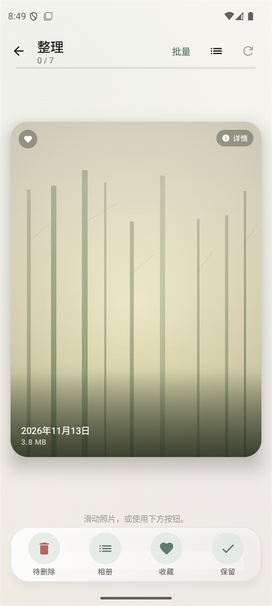
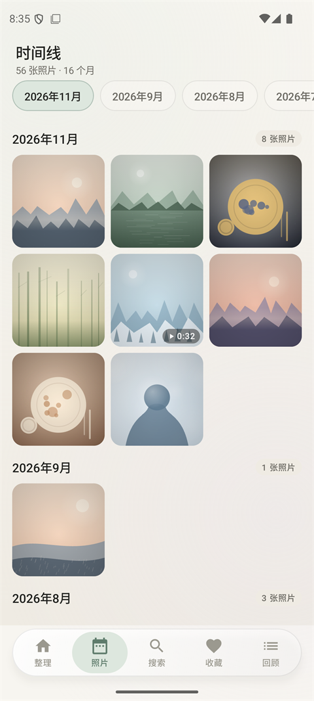
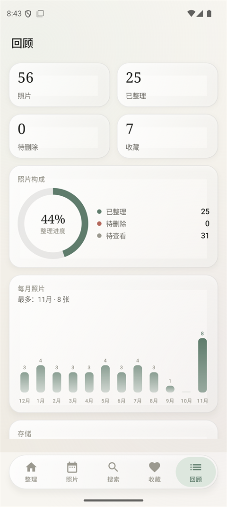
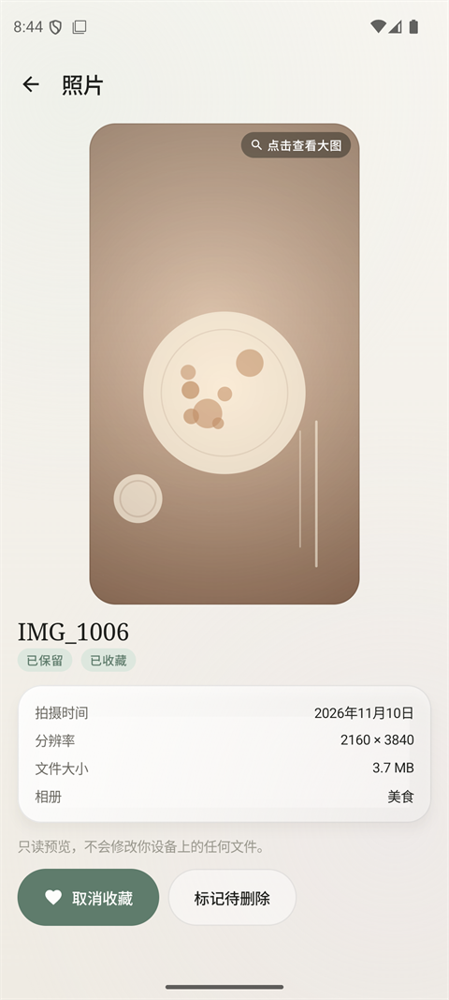

  

<h1 align="center">Photidy</h1>

<b>Powerful underneath. Effortless on the surface.</b> 
A quiet, privacy-first photo organizer for Android.

  <a href="README.md">简体中文</a> · <b>English</b>

  
  
  
  
  
  
  

  <a href="#-download">📥 Download</a> ·
  <a href="#-what-it-does">✨ Features</a> ·
  <a href="#-privacy-and-permissions">🔒 Privacy</a> ·
  <a href="#-faq">❓ FAQ</a> ·
  <a href="#-for-developers">🧑‍💻 Developers</a>

---

Photidy never nags you to empty your camera roll ☕️ It turns “keep or let go?” into a comfortable swipe, hides the boring parts — duplicates, screenshots, burst shots — in the background, and leaves deletion and album moves to Android's own confirmation dialogs. No account, no ads, no subscription. Your photos stay on your device.

  
  
  
  

👆 Swipe to tidy · 🗓️ Timeline · 📊 Insights · 🖼️ Photo detail

## 📥 Download

Grab the latest `Photidy-x.y.z.apk` from **[Releases](https://github.com/jiehua1995/Photidy/releases/latest)**.

| Item | Details |
| --- | --- |
| 📱 Android | Android 10 (API 29) and above |
| 📦 Package | One universal APK for arm64-v8a / armeabi-v7a / x86 / x86_64 |
| 🚀 First launch | Grant photo access, or try the built-in demo library first |
| 💚 Price | Free forever. No account, ads or in-app purchases |

Installing:

1. Download the APK on your phone.
2. If Android asks, allow your browser or file manager to install apps from unknown sources.
3. Launch Photidy and follow the photo-permission prompt. You can decline and keep using the demo library; the source can be switched later in Settings.

> Official builds are signed with the project key. If a build has no signing secrets configured, its file name ends with `-debug-signed` and is meant for testing only.

## ✨ What it does

### 👆 Tidy

- ⬅️ **Four-way swipes**: left for the delete list, right to keep, up to favourite, down to pick an album. Actions and thresholds are configurable.
- 🍃 **Only unorganized photos by default**: opening the same album again does not start from scratch; switch back to all photos in Filters.
- 🗂️ **Batch selection**: skip the swiping and keep or flag many photos at once in a grid.
- 🕘 **Recent filters**: the last three starting filters are remembered and can be reused with one tap.
- 🧭 **Leave and re-pick anytime**: go back to Filters from the organizer to change albums or sort order, including random order.
- ↩️ **Undo**: take back a swipe immediately; anything in the delete list can be restored before deletion.

### 🖼️ Browse and search

- 🗓️ **Timeline**: grouped by capture month, with month chips that jump straight to any month. Undated photos get their own group.
- 🔍 **Search**: search by file name, album name or date such as `2026-11`, case- and separator-insensitive.
- ❤️ **Favourites**: browse what you loved, or tidy only favourites.
- 🔎 **Photo detail**: open any photo full screen with pinch-to-zoom, double-tap zoom and panning.
- 🔁 **Switchable libraries**: move between the device library and the demo library at any time; the choice survives restarts.

### 🧠 Smart tidying

- 🏷️ **Metadata filters**: screenshots, bursts, long videos, large files and likely duplicates. Everything reads only file name, size, resolution and capture time — no pixel decoding, no network.
- 👯 **Duplicate comparison**: groups by size and resolution, shown side by side. Favourites win, then the newest shot; the rest can be flagged in one tap, with in-place undo.
- 🤖 **Optional on-device AI**: downloads a ~4 MB quantized model and classifies photos locally as food, pets, documents, nature or architecture. The first run scans the whole library in the background; later runs only handle new photos. Progress is visible in Settings, and the model can be deleted at any time.
- 📊 **Insights**: composition ring, monthly distribution, storage usage, largest albums, and space reclaimable from the delete list and duplicates.

### 🎨 Look and language

- 🌗 **Three visual styles**: Minimal, Liquid Glass and Fluid Cloud, applied instantly.
- 🌙 **Dark mode**: follow system, light or dark.
- 🫧 **Restrained motion**: press feedback, card entrances and growing bars that respect the system “reduce motion” setting.
- 🌍 **9 languages**: Simplified Chinese, Traditional Chinese, English, Deutsch, 日本語, 한국어, Español, Français, Italiano. The app language can differ from the system language.

## 🔒 Privacy and permissions

> **No sign-up, no uploads, no ads, no analytics or crash-reporting SDKs.** The only network request downloads the optional local AI model.

| Permission | Why |
| --- | --- |
| `READ_MEDIA_IMAGES` / `READ_MEDIA_VIDEO` | Read photos and videos on Android 13+ |
| `READ_MEDIA_VISUAL_USER_SELECTED` | Support “select photos only” on Android 14+ |
| `READ_EXTERNAL_STORAGE` | Read photos on Android 10–12 |
| `INTERNET` | Download the optional AI model only |

If permission is denied or only some photos are shared, the app says so explicitly instead of showing an empty library or a wrong count.

Photidy never edits files directly. Deletions and album moves are queued in the UI, then confirmed through Android's system dialog one at a time; the app updates its state and rescans only after the system reports success. Photos in the system trash can still be restored within Android's window, and the delete-list screen shows how many are restorable and for how many days.

Smart filters use metadata only. Local AI inference happens entirely on the device, and the model lives in the app's private storage — uninstalling the app removes it.

## ❓ FAQ

**Are my photos uploaded anywhere?** 🌐
No. There is no upload code path. The only network request fetches the optional AI model file.

**Can a deleted photo be restored?** 🗑️
Deletion goes through the Android system trash. Whether it can be restored depends on the OS version and the remaining time; Photidy shows the days left in the delete list, and the system gallery's trash works too.

**Why does Photidy need photo permission?** 🔐
Reading a library requires it. You may grant access to only some photos; the app works within what it can see and explains the state.

**Does it work on Android 10?** 📱
Yes. Tidying, browsing, search, favourites and insights all work. System-confirmed deletion and album moves require Android 11+; on older versions the app records the plan without touching files.

**Can I skip the AI feature?** 🤖
Yes, it is off by default. Nothing is downloaded until you enable it, and every other smart filter relies on metadata only.

**Why “unknown source” when installing?** ⚠️
The APK comes straight from GitHub Releases, not an app store, so Android asks for a one-time confirmation.

## 🧑‍💻 For developers

Build instructions, module boundaries, design tokens and the release pipeline are documented in **[docs/DEVELOPMENT.md](docs/DEVELOPMENT.md)** (Chinese):

- 🛠️ Requirements, build and test commands
- 🧱 Module layout and dependency direction
- 🎨 Design system and motion rules
- 🔐 Signing, `dev → main` release flow and GitHub Actions

## 🤝 Contributing

Issues and pull requests are welcome 🎉 Please read [docs/DEVELOPMENT.md](docs/DEVELOPMENT.md) and [.trae/rules/project_rules.md](.trae/rules/project_rules.md) first — module boundaries, privacy rules and tests are mandatory.

- 🌿 Land features and fixes on `dev`, never push straight to `main`
- 🧪 Session engine, filters, stats, duplicates and timeline changes need unit tests
- 🚫 No analytics SDK, no photo uploads, no unnecessary permissions

## 📄 License

[MIT](LICENSE) © Photidy
