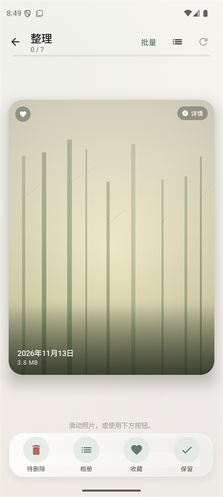
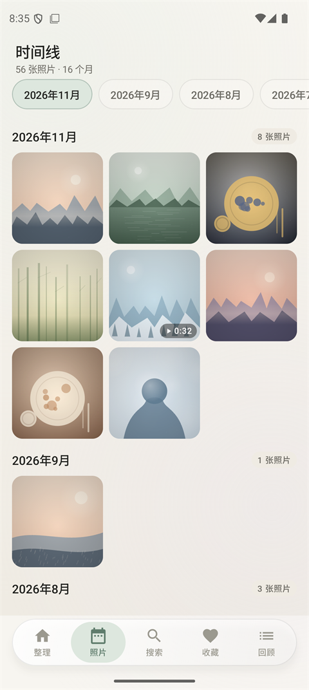
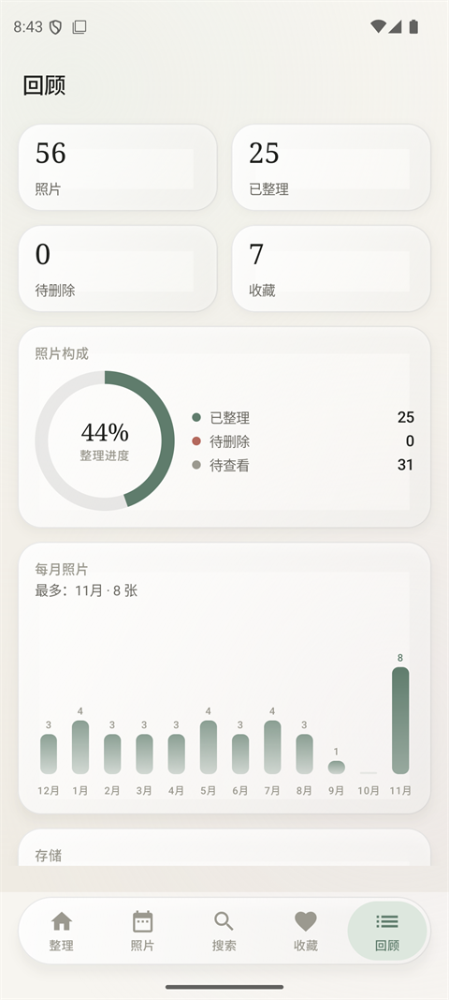
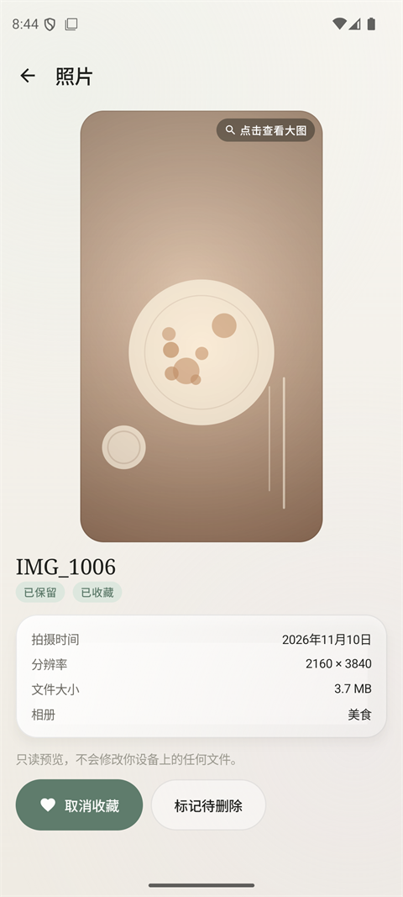

<p align="center">
  
</p>

<h1 align="center">Photidy · 相册轻理</h1>

<p align="center"><b>Powerful underneath. Effortless on the surface.</b><br>
一个安静、精致、隐私优先的 Android 本地照片整理应用。</p>

<p align="center">
  <a href="https://github.com/jiehua1995/Photidy/releases/latest"></a>
  <a href="https://github.com/jiehua1995/Photidy/stargazers"></a>
  <a href="LICENSE"></a>
  
  
  
  
</p>

<p align="center">
  <a href="#下载">下载</a> ·
  <a href="#能做什么">功能</a> ·
  <a href="#隐私与权限">隐私</a> ·
  <a href="#技术栈">技术栈</a> ·
  <a href="#从源码构建">构建</a> ·
  <a href="#常见问题">常见问题</a>
</p>

---

Photidy 不催你清空相册。它把“这张要不要留下”变成一次舒服的滑动，把重复、截图、连拍这些琐碎判断藏进后台，把删除与移动交还给 Android 系统确认。没有账号、没有广告、没有订阅，照片始终留在你的设备上。

<p align="center">
  
  
  
  
</p>

<p align="center"><sub>滑动整理 · 时间线 · 回顾与洞察 · 照片详情</sub></p>

## 下载

前往 **[Releases](https://github.com/jiehua1995/Photidy/releases/latest)** 下载最新的 `Photidy-x.y.z.apk`。

| 项目 | 说明 |
| --- | --- |
| 系统版本 | Android 10（API 29）及以上 |
| 安装包 | 单个通用 APK，覆盖 arm64-v8a / armeabi-v7a / x86 / x86_64 |
| 首次启动 | 可授予照片权限使用本机相册，也可先体验内置演示照片库 |
| 费用 | 永久免费，无账号、无广告、无内购 |

安装步骤：

1. 在手机上下载 APK；
2. 打开文件时若提示“未知来源”，允许当前浏览器或文件管理器安装应用；
3. 启动后按引导授予照片权限。拒绝也能使用内置演示库，随时可在设置里切换来源。

> 正式发布使用项目签名密钥；如果某次构建未配置签名，产物文件名会带 `-debug-signed`，仅供测试安装。

## 能做什么

### 整理

- **四向滑动**：左滑待删除、右滑保留、上滑收藏、下滑选相册，四个方向的动作与触发阈值都可以在设置里改。
- **默认只看没整理过的照片**：第二次打开同一个相册不会从头再来，可在筛选页切回全部照片。
- **批量多选**：不想逐张滑时，进入网格一次保留或标记多张。
- **最近筛选**：自动记住最近 3 次开始整理时的条件，一键复用。
- **随时退出重选**：整理页顶部可返回筛选页，重新挑相册或换排序方式（含随机顺序）。
- **撤销**：滑错了可以立即撤回；待删除清单里的照片在删除前都能拿回来。

### 浏览与查找

- **时间线**：按拍摄月份分组，顶部月份芯片直接跳到任意月份，未标注日期的照片单独归组。
- **搜索**：按文件名、相册名或日期搜索，支持 `2026-11`、`2026年11月` 这类写法，忽略大小写与分隔符。
- **收藏视图**：集中查看收藏照片，也可以只整理收藏。
- **照片详情**：点击大图进入全屏，双指缩放、双击放大、拖动平移。
- **相册来源可切换**：本机照片库与内置演示库随时切换，冷启动会恢复上次的选择。

### 智能整理

- **本地元数据筛选**：截图、连拍、长视频、大文件、可能重复，全部只读文件名、大小、分辨率与拍摄时间，不解码像素、不联网。
- **重复照片对比**：按大小与分辨率分组并排展示，默认优先保留收藏、其次较新的照片，其余一键加入待删除，并支持原地撤销。
- **可选本地 AI 识别**：开启后下载约 4 MB 的量化模型，在本机粗分类为食物、宠物、文档、自然、建筑。首次开启会在后台扫完整个照片库，之后只处理新增照片；设置页可以看到进度，也可以随时删除模型。
- **回顾与洞察**：照片构成环、每月拍摄分布、存储占用、最占空间的相册、待删除与重复照片可回收的空间。

### 外观与语言

- **三种视觉风格**：Minimal、Liquid Glass、Fluid Cloud，切换即时生效。
- **深色模式**：跟随系统、浅色、深色三档。
- **克制的动效**：按压缩放、卡片入场、柱状图生长；配合系统“减少动态效果”自动收敛。
- **9 种语言**：简体中文、繁體中文、English、Deutsch、日本語、한국어、Español、Français、Italiano。语言可单独设置，不跟随系统也没问题。

## 隐私与权限

**不需要注册，不上传照片，不接入广告、分析或崩溃上报 SDK。** 唯一使用网络的地方是下载那个可选的本地 AI 模型。

| 权限 | 用途 |
| --- | --- |
| `READ_MEDIA_IMAGES` / `READ_MEDIA_VIDEO` | Android 13+ 读取本机照片与视频 |
| `READ_MEDIA_VISUAL_USER_SELECTED` | Android 14+ 支持“仅选择部分照片”的授权方式 |
| `READ_EXTERNAL_STORAGE` | Android 10–12 读取照片 |
| `INTERNET` | 仅用于下载可选 AI 模型，不上传任何数据 |

权限被拒绝或只授权了部分照片时，应用会明确说明当前状态，而不是显示成空相册或报出错误的照片数量。

删除与相册移动都不会由应用直接改文件：先在你确认的界面里标记，再通过 Android 系统对话框逐次确认，只有系统返回成功才会更新界面并重新扫描。系统回收站里的照片仍可在 Android 允许的时间内恢复，待删除页会提示还能恢复多少张、还剩几天。

智能筛选只使用元数据，本地 AI 推理全程在设备上完成；模型文件保存在应用私有目录，删除应用即一并清除。

## 技术栈

| 层 | 选型 |
| --- | --- |
| 语言与界面 | Kotlin 2.3、Jetpack Compose、Material 3 |
| 架构 | 多模块、Navigation Compose、Coroutines / StateFlow、ViewModel |
| 本地存储 | DataStore（设置与当前整理快照）、MediaStore（只读媒体） |
| 图片 | Coil（网格按目标尺寸解码缩略图） |
| 本地 AI | TensorFlow Lite + 量化 MobileNet，可选下载、默认关闭 |
| 构建 | Gradle Kotlin DSL、版本目录、`build-logic` 约定插件 |

```
app/                 应用入口、底部导航、主题装配
build-logic/         Gradle 约定插件
core/
  model/             模型、筛选、去重、时间线、统计、会话状态机（纯 Kotlin，可 JVM 单测）
  data/              DataStore、MediaStore、系统确认式写入、AI 模型与推理
  designsystem/      设计令牌、主题、玻璃表面、通用组件
  platform/          设备能力与照片权限判断
  localization/      多语言资源、语言切换、格式化
feature/             home, filters, organizer, review, insights, favorites,
                     timeline, duplicates, search, settings, photodetail
```

业务规则尽量放在 `core:model` 的纯函数里（去重分组、月份分组、统计、会话队列），因此大部分逻辑都能在没有设备的 JVM 上直接测试。所有整理状态只有 `core:data` 一个写入口，页面之间互不依赖，导航由 `app` 串联。

## 从源码构建

需要 JDK 17+、Android SDK Platform 36 与 Build Tools 36.0.0。

```bash
git clone https://github.com/jiehua1995/Photidy.git
cd Photidy
./gradlew :app:assembleDebug
```

APK 输出在 `app/build/outputs/apk/debug/app-debug.apk`。安装到已连接的设备：

```bash
./gradlew :app:installDebug
```

完整的环境要求、模块约定、测试要求、签名与 `dev → main` 发布流程见 **[docs/DEVELOPMENT.md](docs/DEVELOPMENT.md)**。

日常提交推到 `dev`；合并到 `main` 时 GitHub Actions 会自动跑测试、构建 release APK 并创建对应 tag 的 Release。

## 常见问题

**会把我的照片传到服务器吗？**
不会。应用没有上传代码路径，唯一的网络请求是下载可选的 AI 模型文件。

**删除的照片还能恢复吗？**
删除会进入 Android 系统回收站，能否恢复取决于系统版本与剩余时间。Photidy 会在待删除页提示剩余天数；也可以直接在系统相册的回收站里恢复。

**为什么一定要照片权限？**
读取相册内容必须有授权。你可以只授权部分照片，应用会按实际可见范围工作并说明状态。

**Android 10 能用吗？**
可以。整理、浏览、搜索、收藏、洞察都可用；真实删除与相册移动的系统确认接口需要 Android 11 及以上，旧系统上只记录整理计划，不改动文件。

**AI 识别可以不用吗？**
可以，默认关闭。不开启时不下载模型、不申请额外能力，其他智能筛选只依赖元数据。

**为什么安装时提示“未知来源”？**
APK 直接从 GitHub Releases 安装，不经过应用商店，Android 会要求你手动允许一次。

## 参与贡献

欢迎 Issue 与 Pull Request。开始之前请先阅读 [docs/DEVELOPMENT.md](docs/DEVELOPMENT.md) 与 [.trae/rules/project_rules.md](.trae/rules/project_rules.md)：模块边界、隐私约束与测试要求都是硬性的。

- 功能与修复合并到 `dev` 分支，不直接推 `main`
- 会话状态机、筛选、统计、去重与时间线的改动需要补充单元测试
- 不引入分析 SDK，不上传照片，不新增非必要权限

## 许可

[MIT](LICENSE) © jiehua1995
